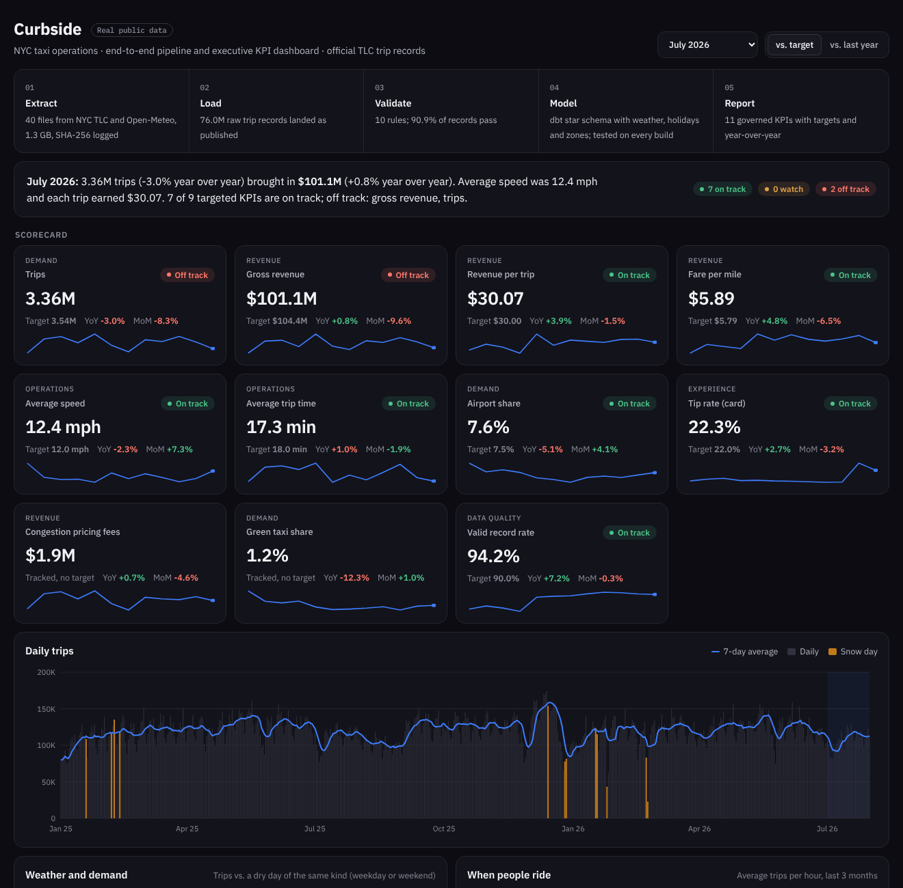
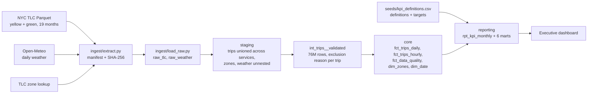

# Curbside: End-to-End Analytics Pipeline & Executive KPI Dashboard

One project, both halves: a production-style data pipeline that moves **76 million real NYC taxi trip records** from the source to a tested warehouse, and the executive KPI dashboard it feeds.



## The pipeline

| Step | What happens |
|---|---|
| **Extract** | Pulls 19 months of official NYC Taxi & Limousine Commission trip files (yellow and green taxis, Jan 2025 to Jul 2026), the taxi zone map, and daily Central Park weather. 40 files, 1.3 GB, each with its URL, row count and SHA-256 in a manifest. |
| **Load** | Lands every file as published in `raw_tlc` and `raw_weather`. Files are matched by column name, so a column TLC added in 2026 arrives as nulls in older months instead of breaking the load. |
| **Validate** | 10 rules check every record. Each excluded trip keeps the first rule it failed. 69.1M of 76.0M records (90.9%) pass. |
| **Model** | dbt builds a star schema: `dim_zones`, `dim_date` (with weather and holidays), and daily, hourly and data-quality facts at the grain the dashboard reads. |
| **Report** | Seven reporting marts, led by a governed KPI scorecard with targets and year-over-year comparisons. |



### What validation catches

| Rule | Records excluded |
|---|---|
| Negative amount (refunds, reversals) | 2,278,217 |
| Zero distance | 1,864,592 |
| No charge, dispute or voided trip | 1,700,864 |
| Drop-off not after pickup | 876,921 |
| Unknown pickup zone | 114,151 |
| Trip over 6 hours | 25,044 |
| Average speed over 80 mph | 18,315 |
| Zero total | 3,980 |
| Distance over 100 miles | 3,455 |
| Pickup outside the file's month | 677 |

Excluded rows are counted, not deleted. A test proves valid plus excluded equals every record loaded, and the build fails if any month loses more than 15%.

## The executive dashboard

- **A written brief** for the selected month: trips, revenue, speed and revenue per trip, with year-over-year change and which KPIs are off track.
- **An 11-KPI scorecard** covering demand, revenue, operations, rider experience and data quality. Each tile shows status against target, year-over-year and month-over-month change, and a 12-month trend. It can switch between "vs. target" and "vs. last year."
- **Drivers:**
  - Daily trips with snow days marked
  - Weather vs. demand
  - An hour-of-week heatmap
  - Borough and zone leaderboards
  - Exclusions by rule

KPIs are defined once in `seeds/kpi_definitions.csv` (definition, unit, which direction is good, target) and computed once in `int_kpis__monthly`. Every tile, the brief and the scorecard read the same numbers.

### Findings in the data

- **July 2026:** 3.36M trips (−3.0% year over year), but revenue held at $101.1M (+0.8%) because revenue per trip rose 3.9% to $30.07.
- **Snow** cuts trips 19% against a comparable dry day. **Rain raises them** about 3%: people who'd walk take a cab.
- **Manhattan** made up 87% of yellow and green pickups in July 2026. JFK is the second-busiest pickup zone, at about $79 per trip.
- **Congestion pricing** (started January 5, 2025) adds about $1.9M a month in fees on taxi trips alone.

## Tests

53 tests run with `dbt build`:

- Grain uniqueness on every fact and mart
- Relationships (facts to zones, dates and payment types; the scorecard to the KPI catalog)
- Accepted values for services, exclusion reasons, weather types and KPI status
- Range checks
- Singular tests:
  - `assert_every_raw_record_accounted_for`
  - `assert_rows_reconcile_to_manifest`: per file
  - `assert_rollups_match_valid_trips`: the daily and hourly facts equal the valid trips exactly, including revenue
  - `assert_excluded_share_under_limit`
  - `assert_every_kpi_every_month`

## Run it

```bash
git clone https://github.com/evannwilsonn/curbside.git
cd curbside
python -m venv .venv && source .venv/bin/activate
make setup   # pip install -r requirements.txt
make all     # extract (~2 min download) → load (~1 min) → dbt build (~1.5 min) → dashboard data
make serve   # http://localhost:8000
```

## Run it on Snowflake

The models dispatch to DuckDB or Snowflake SQL through `macros/cross_db.sql`. The weather model has a Snowflake branch that uses `LATERAL FLATTEN`. The Snowflake path is written to run as-is but has only been run end to end on DuckDB so far.

```bash
pip install dbt-snowflake
python ingest/extract.py
snowsql -a <account> -u <user> -f ingest/snowflake_load.sql
export SNOWFLAKE_ACCOUNT=<account> SNOWFLAKE_USER=<user> SNOWFLAKE_PASSWORD=<password>
dbt build --target snowflake
```

## Data

- [NYC TLC Trip Record Data](https://www.nyc.gov/site/tlc/about/tlc-trip-record-data.page): official public trip records from the NYC Taxi & Limousine Commission. The data is downloaded by `make all` and not stored in this repo.
- [Open-Meteo Historical Weather API](https://open-meteo.com/), CC BY 4.0.

Targets in the KPI catalog are illustrative plan figures set for this project.

Built by Evan Wilson · Python · DuckDB · dbt · Snowflake · SQL · HTML/SVG
